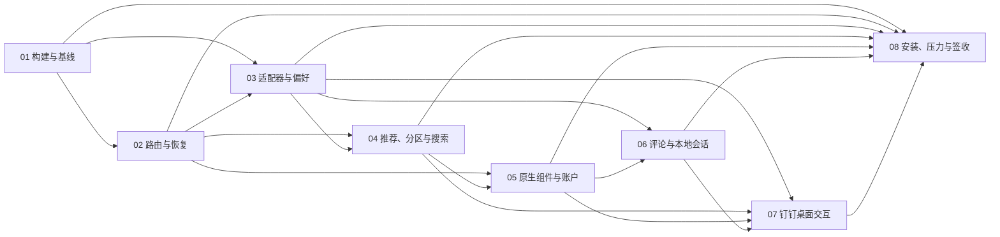

# DingBili P1 任务依赖与交接条件

**状态为待评审。** 人工批准启动 P1 后，首个可执行任务是 P1-01。下表的「通过」指未来候选版本需要提供的证据。P0 的静态结论、合成页面实测和匿名实站抽查可用来建立对照，不能代替候选产物验收。

## 直接依赖图

箭头从交付前置产物的一方指向使用方。P1-08 接收前七项各自的验收记录。

## 八项交接

| 任务 | 直接前置 | 输入与交付 | 下游接收条件 |
|---|---|---|---|
| **P1-01 冻结行为基线与单文件构建** | 无工程前置。先经人工批准 | 读取 BiliShu 0.6.1 固定快照、元数据、许可和 P0 样本。交付来源清单、可重复单文件构建及能分别表达既有行为与已知缺陷的回归样本。 | 相同输入可重建同一份 `DingBili.user.js`，元数据位于首部，保留原许可及署名。样本能复核上游行为，已知错误作为后续修复的失败案例。[依赖与许可](P0-audit/reports/DEPENDENCIES.md) |
| **P1-02 路由、生命周期与切回原版** | 01 | 接收可安装产物与基线。交付文档/路由会话、资源登记与释放、可随时返回原版的入口。为 05 提供原生宿主借还的公共生命周期。 | 覆盖初始未支持页转支持页、push/replace/pop、延迟或更换宿主、前进后退缓存。连续 20 次往返同时最多有一个活动壳，同一次导航处理一次。下列四路均核对原站可用性。[风险 R02、R05、R07](P0-audit/reports/RISK_REGISTER.md) |
| **P1-03 抽取 Site Adapter 与 Theme Adapter** | 01、02 | 接收单文件构建及会话/清理接口。交付 Site Adapter 的数据与原生动作契约、Theme Adapter 的渲染契约、三主题回归输入，以及 www/search 两个 origin 的默认值、旧值、用户修改与存储失败策略。 | 内存假站点能提供同一组数据给三主题。主题无需定位 B站 DOM。无来源直达且无显式偏好时默认钉钉。从 www 首次主动进入 search，目标域没有显式偏好时沿用出发页当前合法主题；目标域已有显式选择时优先使用目标域设置。旧值升级及存储失败时按书面契约回退。04 接收该契约与空存储样本，负责首次实际导航的端到端验收。[架构提案](P0-audit/reports/ARCHITECTURE.md) |
| **P1-04 修复推荐、分区、导航和搜索** | 02、03 | 接收路由、双适配器与偏好契约。交付首页/分区/搜索视图、完整原 URL、列表变更和原生排序翻页动作，向 05 传递视频 ID、分 P、起播时间及返回来源。 | 验收首次检索三条路径。无来源直达空 search 默认钉钉；www 选定任一合法主题后首次搜索至空 search，首次呈现即沿用该主题；目标域已有显式偏好时优先使用目标选择。上下游都无偏好时两域均为钉钉。人工预置双域主题的 H02 不满足这些用例。21 个分区目标正确，普通卡不丢 p/t，动态修改与换批有可复现结果。分页每次至多调用一次原站动作，失败可重试。300 卡 T07 对照中无关变化引起的标题重读为 0，新增卡仍被识别。[数据映射](P0-audit/reports/DATA_MAPPING.md) |
| **P1-05 原生视频、账户与编辑器** | 02、04 | 接收恢复机制、视频目标和返回地址。交付播放器/编辑器独占借用与归还、匿名/已登录原生账号入口、原生回复目标读取和取消能力。目标变化监听必须可解绑并能在下一次进入时恢复。 | 正常归还时节点、顺序、属性和焦点可核对；锚点被换时原站仍可播放或编辑。无双音轨或重复监听。局部用例应能观察「选中 → 原生取消 → 无目标」及切换目标；原站不提供可判定状态时退原版。具备样本后分别核对分 P、起播、倍速、全屏与弹幕。06 接收目标状态、取消结果与监听释放的证据。[播放和评论验证](P0-audit/reports/TESTING_PLAN.md) |
| **P1-06 评论、楼中楼与模拟会话** | 03、05 | 接收类型化动作、可恢复的原生编辑器和回复状态。交付真实评论/楼层的分页、引用与公开回复，以及本机模拟聊天持久化。以站点及模拟会话 ID 区分记录，标明 origin 范围、恢复与超限淘汰规则。 | 完成端到端「回复甲 → 取消 → 顶层」「回复甲 → 改选乙 → 以乙为目标」及目标节点替换。只在原站确认后标已发布，主楼和子楼能分别表达加载/结束/失败。原有 16 个模拟会话可进入，每会话最多 100 条自录消息、每条最多 5,000 个 UTF-16 码元；同 origin 刷新或重开后恢复，互不串写。模拟发送触发真实写动作 0 次，真实评论不进入模拟记录。本计划以浏览器配置、站点 origin、虚拟会话 ID 为保存范围；不跨 origin 或配置同步。浏览器重启、多标签并发和存储失败的证据见 A06。[楼层与会话基线](P0-audit/reports/DATA_MAPPING.md) |
| **P1-07 钉钉桌面交互与小窗** | 03、04、05、06 | 接收三主题契约与已可操作的浏览、账号、播放、评论和同事会话。目标钉钉桌面版本及对照画面用于视觉签收。 | 1440×900、1280×720、900×800 均能从列表进入视频、评论楼层或同事会话，返回列表并切原版。键盘焦点、深浅色和主要操作均可见可用。装饰项不能产生操作成功反馈。另两主题用相同数据做核心回归。[三主题功能矩阵](P0-audit/reports/FEATURE_MATRIX.md) |
| **P1-08 安装、兼容、性能与发布评审** | 01、02、03、04、05、06、07 | 接收前七项交付与证据，基于同一构建物做脚本管理器安装、承诺支持的浏览器组合、压力/恢复与人工评审。 | 记录产物标识、浏览器/管理器版本、环境和每项结果。复核四路恢复及下述压力标准。逐列区分已验证、已失败、待测；核心未验证项不能计通过。是否发布由人工评审决定。[测试基线与缺口](P0-audit/reports/TESTING_PLAN.md) |

## 四路原页恢复矩阵

02 建立比较基准，05 补播放器/编辑器与监听器的所有权证据，06 验证真实与模拟动作隔离，08 使用安装后的候选产物复核。退出壳层时只撤销本次仍然拥有的改动。原站已替换图标或宿主时，应尊重新对象。[页面恢复证据](P0-audit/reports/RISK_REGISTER.md)

| 必测路径 | 进入条件与操作 | 通过判据 |
|---|---|---|
| **F1 SPA 跳转** | 在同一文档上从支持页去未支持页，再返回；覆盖 push、replace、pop 触发的局部路由和跨视频跳转。 | 不支持页可直接操作。退出时比对原 title、favicon 节点及 id/href、根类、内联样式/colorScheme、布局变量、焦点、原生节点身份和顺序。旧页监听、计时器及异步回调不再作用于新页，回到支持页只挂一套壳。 |
| **F2 整页刷新** | 在首页、搜索和带 p/t 参数的详情选择原版并刷新；另测保持 IM 时的刷新。视频或编辑器已展开、原宿主已换两种情况都覆盖。 | 原版模式下新文档无壳层遮挡，原生标题、图标、布局、播放器和编辑器可用。IM 模式刷新后只挂一次，URL 参数保留，无重复音轨和旧回复目标。 |
| **F3 浏览器前进后退** | 用浏览器真实后退/前进在首页、分区、搜索、详情之间往返；覆盖同文档历史和跨文档历史，分别记录是否命中 bfcache。 | 返回的页面与 URL、来源、模式相符。不串视频、评论或焦点；缓存恢复的文档能继续观察新内容，活动壳及订阅不叠加。原版历史项恢复后可直接操作。 |
| **F4 冷启动** | 完全关闭浏览器后，在同一配置中直接重开支持页、未支持页及保存原版偏好的 URL；另用无偏好的新配置直达，检查两个 origin 的缺省行为。 | 初始未支持页原生可用，再同文档进入支持页能挂载。保存原版模式时能直接访问原页；无来源直达的新配置按 03 的默认值启动。原生节点和样式仅受当前会话拥有的改动影响。 |

每项原生页面恢复用例均须运行 F1–F4 并分别记录，单一路径成功不能替代其余三路。额外变体包括主动切回原版、管理器停用后刷新/新开、原父节点或锚点消失、站方替换 favicon，以及未匹配或延迟挂载。停用当下和刷新后的状态分别记录。05/06 对比播放器、评论编辑器、原生取消状态和焦点，无法归回原位置时须使站方现有组件可用。

## 验证依赖与压力标准

- **真实账户及公开动作。** H02 看到了真实匿名评论宿主及两条根评论，T06 触发了合成控件的回复回调。05/06 的已登录分支和公开提交需要有权限的测试人员、明确测试对象与站方状态或回执。记录行为和结果即可，凭据不进入日志、夹具、报告或本地模拟记录。[测试记录](P0-audit/reports/TESTING_PLAN.md)
- **播放器、视觉与兼容性。** H03 的一个匿名视频实际播放至约 5.786 秒，不能推及多 P、长播和所有控件。05 需要覆盖这些能力的真实样本；07 的视觉相似度需要经评审指定的版本和参考画面；08 需要实际安装条件与承诺的 Chrome、Edge、Firefox 组合。缺少输入时可完成独立项，相关结论单列待测。[审计总览](P0-audit/reports/AUDIT_REPORT.md)
- **08 压力验收。** 在相同机器、浏览器、数据规模下对照原生页、上游 0.6.1 和候选版，连续运行至少 30 分钟，累计至少 100 次会话切换，涵盖推荐群、分区群与模拟同事，包含同一路由内切换，按活动会话实际变更计数。同期重复打开/关闭视频详情。50 轮为本计划补定的门槛，批准后须至少达到 50 个完整周期，一开一关算一轮；会话切换与详情周期分别计数。逐次记录有效动作和失败动作；起点、每 5 分钟、每 10 轮详情和最终退壳后采集观察器、监听、定时器、脱离 DOM 的宿主、堆内存与长任务数据。连续负载结束后再补测刷新、前进后退和冷启动。P0 的 100 卡、100 根评各 10 子回复可作可重复负载。确定性门槛为每页最多一套壳、旧页监听/计时器已释放、无双音轨、无串楼、无旧回调改写下一页。耗时、内存波动应相对同机基线先约定阈值，再按实测报告；上述时长/次数是候选验收目标。[P0 性能基线](P0-audit/reports/TESTING_PLAN.md)

## 来源交接

01 建档、08 核对分发包。直接来源为 `Jack-Cherish/BiliShu` 的 `da8b9722a778c94440e826a02559c8da3692b546`，脚本版本 0.6.1；祖先为 `czm15053/linuxdo-idea-ui` 的 `88653fc24432f6dfc61b26d488afc74f05eb230c`。候选包保留脚本头中的 MIT 全文、免责声明、`Copyright (c) 2026 czm15053`、BiliShu 移植署名与来源，并单列 DingBili 的改动。演示 GIF、内嵌头像及品牌标识按件登记来源与拟分发范围。源文件和工作区审计快照继续作为只读对照。[原始用户脚本](P0-audit/upstream/bilishu.user.js) · [许可与素材核对](P0-audit/reports/DEPENDENCIES.md)
